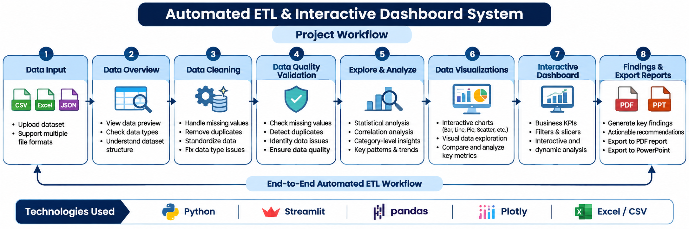

# Automated ETL & Interactive Dashboard System

A Python and Streamlit application that brings common data analyst workflow steps into one interactive interface. Upload a dataset, inspect its structure, review and clean data-quality issues, analyze the data, build visualizations, explore an interactive dashboard, and export reports.

---

## Project Overview

This project combines data preparation, validation, exploration, visualization, and reporting in one guided application. It supports different tabular datasets and uses available columns to guide KPI generation, analysis, and visualizations. Automated suggestions and observations are heuristic and should be reviewed before being used as final business conclusions.

## Project Workflow

**Upload Data → Data Overview → Data Cleaning → Data Quality Validation → Explore & Analyze → Data Visualizations → Interactive Dashboard → Findings & Export Reports**



## Key Features

- **Dataset Upload:** Upload CSV, Excel, and JSON datasets.
- **Data Overview:** Review dataset dimensions, columns, data types, previews, and summaries.
- **Data Cleaning:** Review column-wise recommendations, handle missing values, review duplicates, and apply supported data-type conversions.
- **Data Quality Validation:** Check missing values, duplicate records, and possible identifier issues.
- **Explore & Analyze:** Explore descriptive statistics, category-level summaries, correlations, and supported aggregations.
- **Data Visualizations:** Create supported bar, column, line, pie, donut, scatter, histogram, box, treemap, heatmap, and gauge charts.
- **Interactive Dashboard:** Review available KPIs, apply dataset filters, and explore visualizations.
- **Findings & Export Reports:** Review data-based findings and recommendations, and export PDF and PowerPoint reports.

---

## Application Screenshots

### 1. Application Home


### 2. Data Overview


### 3. Data Cleaning


### 4. Data Quality


### 5. Explore & Analyze


### 6. Visualization Options


### 7. Visualization Example


### 8. Interactive Dashboard


### 9. Dashboard Analysis


### 10. Findings & Recommendations


### 11. Reports Exporting


---

## Technology Stack

| Technology / Library | Purpose |
|---|---|
| Python | Core application language |
| Streamlit | Interactive web application |
| Pandas | Data loading, transformation, and analysis |
| NumPy | Numerical operations |
| Plotly | Interactive data visualizations |
| openpyxl | Excel `.xlsx` file support |
| xlrd | Legacy Excel `.xls` file support |
| ReportLab | PDF report generation |
| python-pptx | PowerPoint report generation |

## Project Structure

```text
Automated-ETL-Dashboard-System/
├── app.py
├── README.md
├── requirements.txt
├── .gitignore
├── Assets/
│   ├── Images/
│   │   └── Automated ETL Dashboard WorkFlow.png
│   └── Screenshots/
│       ├── 01. Application Home.png
│       ├── 02. Data Overview.png
│       ├── 03. Data Cleaning.png
│       ├── 04. Data Quality.png
│       ├── 05. Explore & Analyze.png
│       ├── 06. Visualization options.png
│       ├── 06. Visualization1.png
│       ├── 07. Dashboard_1.png
│       ├── 08. Dashboard_2.png
│       ├── 09. Findings & Recommendations.png
│       └── 10. Reports Exporting.png
├── Data/
│   ├── Raw_Data.csv
│   └── Cleaned_Data.csv
├── Docs/
│   └── project_documentation.md
├── Reports/
│   ├── Raw_Data_csv_analysis_report.pdf
│   └── Raw_Data_csv_analysis_presentation.pptx
└── venv/  # Local environment; excluded from Git
```

## Installation and Setup

### Prerequisites
- Python installed on your computer
- pip (Python package installer)

### 1. Clone the repository

```bash
git clone https://github.com/KarthikKasakani2004/Automated-ETL-Dashboard-System.git
cd Automated-ETL-Dashboard-System
```

### 2. Create a virtual environment

```powershell
python -m venv venv
```

### 3. Activate the virtual environment

For Windows PowerShell:

```powershell
Set-ExecutionPolicy -Scope Process -ExecutionPolicy Bypass
.\venv\Scripts\Activate.ps1
```

### 4. Install dependencies

```powershell
python -m pip install --upgrade pip
pip install -r requirements.txt
```

### 5. Run the application

```powershell
python -m streamlit run app.py
```

Open the local URL displayed in the terminal, usually `http://localhost:8501`.

## How to Use

1. Run the Streamlit application.
2. Upload a CSV, Excel, or JSON dataset.
3. Review the dataset overview.
4. Inspect and apply suitable data-cleaning actions.
5. Review data-quality checks.
6. Explore analysis and visualizations.
7. Use dashboard filters to investigate the data.
8. Review findings and recommendations.
9. Export a PDF or PowerPoint report if required.

## Data and Interpretation Notes

- The repository includes sample raw and cleaned datasets and example reports for demonstration. Ensure shared data is public or synthetic and contains no private or confidential information.
- Suggested primary keys, cleaning actions, KPIs, and automated findings should be validated against the dataset's business meaning.
- Missing-value treatments should be selected carefully because they can affect analysis results.
- Potential outliers are candidates for review, not automatically errors.
- Some visualizations require particular combinations of categorical, numeric, date, or geographic fields.
- PDF and PowerPoint exports require their respective libraries to be installed.
- Chart images in exported reports may depend on Plotly image-rendering support.

## Future Enhancements

- More configurable and reusable data-cleaning pipelines.
- Additional domain-specific KPI definitions.
- Expanded data formats and large-file handling.
- Automated tests for data transformations, calculations, and exports.
- Additional report customization and deployment options.

## Author

- **Name:** Karthik Kasakani
- **GitHub:** [KarthikKasakani2004](https://github.com/KarthikKasakani2004)
- **Project Repository:** [Automated-ETL-Dashboard-System](https://github.com/KarthikKasakani2004/Automated-ETL-Dashboard-System)
- **LinkedIn:** https://www.linkedin.com/in/karthik-kasakani

## License

Add an appropriate open-source license before distributing or reusing this project. Do not claim a license until one has been selected and added to the repository.
